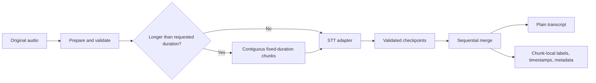
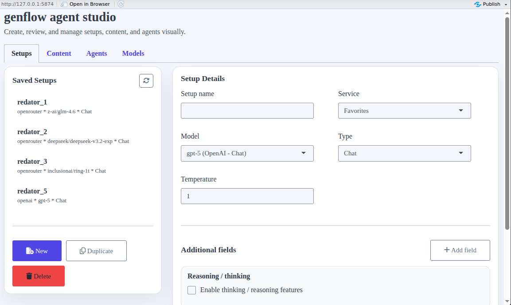
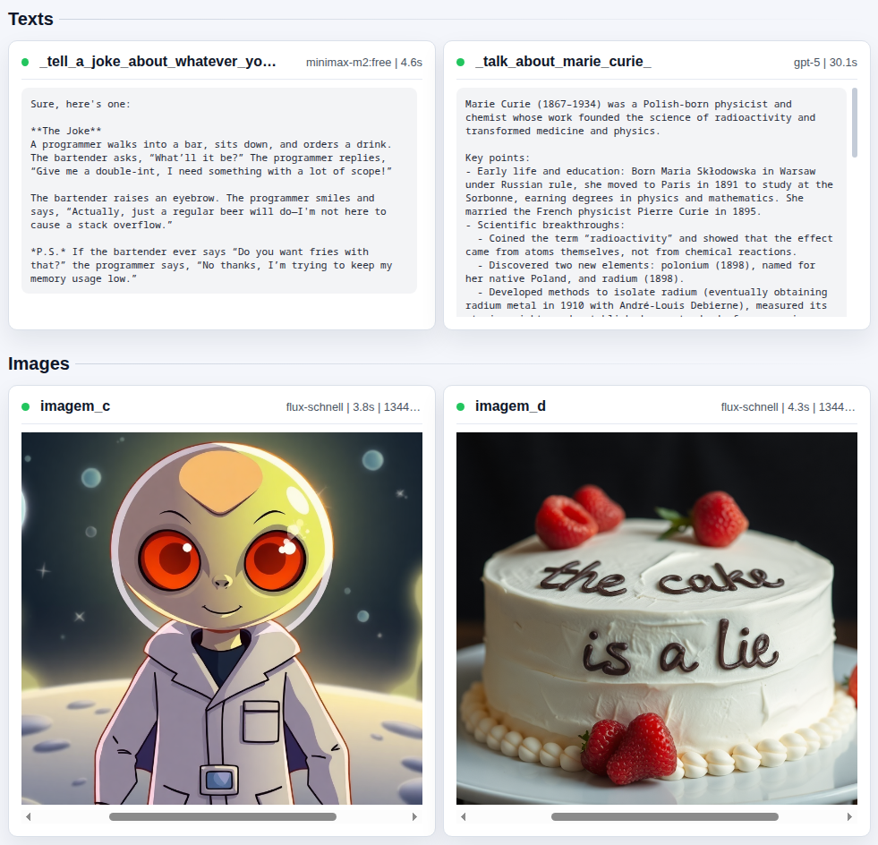

# 🌊 genflow — AI Generation Toolkit for R

[](https://lifecycle.r-lib.org/articles/stages.html#experimental)
[](https://www.r-project.org/)
[](https://www.gnu.org/licenses/gpl-3.0)

> **Easy generative AI workflows for R.** Generate text, images, transcripts,
> and speech with cloud APIs or local models — through one consistent interface.

**genflow** connects R to OpenAI, OpenRouter, Gemini, Hugging Face, Replicate,
FAL, Ollama, llama.cpp, native speech engines, and custom OpenAI-compatible
servers. It also gives you reusable agents, parallel batches, model catalogs,
structured results, and a Shiny/RStudio management app.

<p align="center">
  <a href="#-getting-started">Getting started</a> ·
  <a href="#-everyday-examples">Examples</a> ·
  <a href="#-asr-for-real-world-recordings">ASR</a> ·
  <a href="#-reusable-agents">Agents</a> ·
  <a href="#-function-reference">Reference</a>
</p>

## ✨ Why genflow?

- 🚀 **One interface:** a shared result contract across text, image, STT, and TTS
- 🌐 **Cloud and local:** switch providers without rebuilding your R workflow
- 🎙️ **Serious ASR:** long-audio chunking, resume, retries, diarization, and
  explicit chunk-local speaker labels
- 🧠 **Reusable agents:** save setups and content, then pipe them into generators
- ⚡ **Parallel batches:** separate task count from worker concurrency and
  checkpoint individual results
- 🔄 **Model catalogs:** discover cloud models and manage downloaded native
  speech models
- 👁️ **Built-in viewer:** inspect generated text and media without leaving R
- 🖥️ **Interactive app:** manage credentials, models, local runtimes, and agents

| Create | Function | Typical use |
|:--:|---|---|
| ✍️ | `gen_txt()` | Text, reasoning, vision, and tool-aware prompts |
| 🖼️ | `gen_img()` | Image generation from prompts and optional references |
| 🎙️ | `gen_stt()` | Cloud or local speech-to-text |
| 🔊 | `gen_tts()` | Speech synthesis |
| 🎵 | `gen_music()` / `gen_sfx()` | Music and sound effects |

Runtime contracts, migration notes, and the boundaries for embedding Genflow
in a separate application are described in
[the runtime contract](inst/doc/runtime-contract.md). Version 0.0.9 shares
request preparation between direct calls and batches, exposes
`gen_capabilities()`, and distinguishes inference failures from file-save
failures without discarding generated content.

## Declarative validation

Version 0.0.11 adds an offline, versioned block catalog shared by execution and
workflow validation. `gen_validate_call("gen_img", list(prompt = "A garden"))`
returns prepared defaults and all argument errors without generating an image.
`gen_validate_structure(document)` checks a JSON workflow, fragment, or complete
Studio export bundle with its agents, prompts and subworkflows,
including connections, types and cycles. Direct generators perform the same
argument checks before provider work.

Version 0.0.14 adds `gen_materialize_structure(document, prefix, node_ids)`:
validate and prepare a selected workflow fragment, including its ancestors,
without executing it. It preserves authored arguments, namespaces identifiers
and returns the same portable format for an application to preview and apply.

Version 0.0.23 adds `gen_extract_structure(document, node_ids)`: keep exactly the
selected pieces, expose their typed input/output boundaries and reuse the result
as an ordinary workflow. `subworkflow` and `foreach` use a stable `workflow_id`;
the application resolves publications and freezes execution. Reference discovery
and remapping are shared through `gen_definition_references()` and
`gen_remap_definition()`.

See [block contracts and the workflow format](inst/doc/block-contracts.md) for
examples, supported schema keywords, validation limits and versioning.

Version 0.0.15 adds [canonical diagnostics](inst/doc/diagnostics.md): stable codes,
pt-BR messages, rule parameters, original document paths, piece/field context
and nested causes. `gen_error_catalog()` exposes the schema and message catalog;
`gen_error_summary()` formats a diagnostic for people. Execution decisions use
explicit outcome and retry fields, independently of translated explanations.

Service/model [parameter schemas](inst/doc/parameter-schemas.md) add immutable
revisions, validated `model_options` and portable snapshots to the same contracts.
They reuse the existing model catalog directory and the public management API;
workflows can carry their selected schema without installing it globally.

## 🚀 Getting Started

### Installation

```r
# install.packages("pak")
pak::pak("hugorteixeira/genflow")
```

### Your first call

Keep cloud credentials in environment variables rather than scripts. The app
can add, import, or remove supported keys from your user `.Renviron`:

```r
library(genflow)
gen_interface()
```

Open **Models > Credentials**, save the key, refresh that provider's catalog,
and select a model in a setup or agent.

<details>
<summary><strong>Prefer to configure credentials manually?</strong></summary>

```text
OPENAI_API_KEY=...
GOOGLE_API_KEY=...       # GEMINI_API_KEY is also accepted
HUGGINGFACE_API_TOKEN=...
REPLICATE_API_TOKEN=...
FAL_KEY=...
```

Use `usethis::edit_r_environ()`, then restart R or reload the file with
`readRenviron("~/.Renviron")`. Secrets are not stored in agents, catalogs,
local-inference settings, or exported bundles.

</details>

Generate text and inspect the normalized result:

```r
result <- gen_txt(
  context = "Explain why reproducible backtests need point-in-time data.",
  service = "openai",
  model = "gpt-5-mini",
  reasoning = "medium"
)

result$status_api
result$response_value
```

OpenAI text calls accept `max_output_tokens` to cap generated tokens, including
reasoning. For example, use `reasoning = "minimal", max_output_tokens = 1024`
for a small test. This cap also works in saved agents and batches; inspect
`truncated` before using incomplete output. Other services currently reject
this explicit parameter. `NULL` keeps the provider default.

Every high-level generator returns a list with `response_value`, `service`,
`model`, `duration`, `status_api`, and `status_msg`. Text adds token estimates;
successful media calls add saved-file information.

Generated files default to `~/.genflow`. Change the root globally with:

```r
options(genflow.output_dir = "/absolute/path/to/genflow-output")
```

## 💡 Everyday Examples

### Local text with Ollama or llama.cpp

```r
ollama_result <- gen_txt(
  "Summarize this release note in five bullets.",
  service = "ollama",
  model = "llama3.2"
)

llamacpp_result <- gen_txt(
  "Draft a concise incident report.",
  service = "llamacpp",
  model = "local-model"
)
```

The default endpoints are `http://127.0.0.1:11434` for Ollama and
`http://127.0.0.1:8080` for llama.cpp. genflow talks to these servers; it does
not install or supervise them.

### Image generation

```r
image_result <- gen_img(
  prompt = "A clean isometric diagram of a reproducible data pipeline",
  service = "openai",
  model = "gpt-image-2",
  h = 1024,
  y = 1024
)

gen_view(image_result)
```

References may be paths, HTTP(S) URLs or image data URIs. Pass one string or an
ordered vector/list, including `previous_image$response_value`. Reference support
is model-specific; inspect `gen_capabilities(service, model)$image_references`.
OpenAI GPT Image edits (up to 16 references) and `fal-ai/flux-2/edit` (up to four)
are mapped. Other models reject references rather than silently dropping them.

```r
scene <- gen_img("Reference 1 is the rabbit; reference 2 is the cat, in a garden",
                 add_img = c("rabbit.png", "cat.png"),
                 service = "openai", model = "gpt-image-2")
```

Image calls require FFmpeg and ffprobe. A successful result is one decoded PNG,
JPEG or WebP, even when delivered as a URL, base64, bytes or a ZIP with one image.
`result$image` contains actual format, MIME and dimensions; `dimensoes` now reports
the real image dimensions. Sources are bounded to 50 MiB and 64 million pixels.
A ZIP is streamed without extracting provider-controlled paths. Multiple outputs
are rejected explicitly; use separate calls to generate alternatives.

If generation succeeded but download/validation/publication failed, the result
retains `inference_status = "SUCCESS"`, `status_api = "ERROR"` and an
`image_receipt`. `gen_img_recover(result, persist = FALSE)` reprocesses that receipt
without another inference. Receipts can contain expiring URLs or image bytes;
store them with your job, not in public diagnostics. Batch automatic recovery
retains these failures for explicit media recovery. Invalid media stays invalid.

### Cloud speech-to-text

```r
transcript <- gen_stt(
  "interview.ogg",
  service = "openai",
  model = "whisper-1"
)

transcript$response_value
```

### Text-to-speech

```r
speech <- gen_tts(
  "The validation run completed successfully.",
  service = "openai",
  model = "gpt-4o-mini-tts",
  voice = "alloy"
)
```

For local VoxCPM2, set `service = "local-native"` and describe the voice with
`instructions = "A young woman with a gentle and warm voice"`. Genflow formats
the engine input automatically. Use `reference_audio` to reuse a character's
voice; this adapter has no named `voice` catalog. See
[native TTS](inst/doc/local-inference.md#native-speech-synthesis-voxcpm2) and
[service/model schemas](inst/doc/parameter-schemas.md#example-reusable-voice-descriptions)
for free-form descriptions or registered choices.

### Music and sound effects

```r
# Set ELEVENLABS_API_KEY in the environment, never in a saved workflow.
sfx <- gen_sfx("Small bird flapping its wings", duration_seconds = 2)
music <- gen_music("Gentle piano and flute, a children's story", duration_seconds = 30)
song <- gen_music("Gentle acoustic folk", instrumental = FALSE,
                  lyrics = "Hello, my friend\nLet us play again", duration_seconds = 30)

# Existing ACE-Step 1.5 REST server. No model installation/loading is performed.
local_music <- gen_music("Gentle piano", service = "acestep",
                         model = "acestep-v15-turbo", format = "wav")
```

`gen_sfx/1` and `gen_music/1` own defaults and validation, just like the other
block contracts. They return the common result fields plus `audio` metadata.
`duration` is elapsed execution time; `audio$duration_seconds` is measured
media duration, and `audio$requested_duration_seconds` records the request.
The actual format is detected from bytes; a provider returning a different
valid format is reported accurately rather than given a misleading extension.
FFmpeg and ffprobe are required. One output up to 150 MB and 660 seconds is
validated and decoded before publication.

ElevenLabs supports SFX models `eleven_text_to_sound_v2` and
`eleven_text_to_sound_v3` (default), and music models `music_v1`, `music_v2`,
`music_v2_5` (default). Music defaults to instrumental; vocals require explicit
lyrics and `instrumental = FALSE`. The lyrics adapter sends one section/chunk,
limited to 120 seconds, 30 lines and 200 characters per line. Instrumental
music supports 3–600 seconds; SFX supports 0.5–30 seconds or automatic length.
Music accepts MP3/Opus; SFX also accepts WAV. Account entitlements still apply.
Seed is supported for explicit lyrics, not the ElevenLabs prompt-only route.

ACE-Step uses `ACESTEP_BASE_URL` (default `http://127.0.0.1:8001`) and optional
`ACESTEP_API_KEY`. It supports 10–600 seconds and MP3/WAV/Opus/FLAC/AAC. The
adapter submits one text-to-music task, with automatic lyric/caption rewriting
and thinking modes disabled. It polls the same task and downloads only from
the same server's `/v1/audio` endpoint. Local hardware and server installation
are managed outside Genflow. `ELEVENLABS_BASE_URL` or explicit `base_url` can
override the corresponding API endpoint; endpoints are part of runtime/cache
identity, while credentials are not saved in receipts.

A timeout after submission may have an unknown outcome. If the result contains
`audio_receipt`, `gen_audio_recover(result, persist = FALSE)` queries/downloads
and publishes the **existing** result; it never submits another generation.
Without a receipt, Genflow cannot safely recover a missing provider response.
Batch automatic recovery preserves ambiguous or successful inferences instead
of resubmitting them. Use agents of type `Music` or `SFX`; these use the same
functions in sequential or PSOCK batches. `gen_update_models()` supports both
services: ElevenLabs lists documented adapter models (not account availability),
while ACE-Step lists models already loaded on its server.

Provider contracts: [ElevenLabs SFX](https://elevenlabs.io/docs/api-reference/text-to-sound-effects/convert),
[ElevenLabs Music](https://elevenlabs.io/docs/api-reference/music/compose),
[ACE-Step REST API](https://github.com/ace-step/ACE-Step-1.5/blob/main/docs/en/API.md).
Volume, fades and timeline composition are separate from generation.

## 🎙️ ASR for real-world recordings

`gen_stt()` can prepare a recording, split it into contiguous fixed-duration
chunks when requested, resume completed parts, retry transient failures,
namespace independently produced speaker labels, and return one auditable
result. It does not overlap chunks or guess speaker identity between them.

### Choose where transcription runs

| Path | `service` | Best for |
|---|---|---|
| ☁️ Managed API | `openai`, `groq`, `assemblyai`, `cloudflare`, `voicegain`, `hf`, `replicate` | Minimal local setup |
| 🏠 Native CLI | `local-native` | GGUF speech models through CrispASR or moss-transcribe.cpp |
| 🔌 Your server | `local-openai` | Any server implementing the OpenAI multipart transcription contract |

### Native ASR quick start

Configure a compiled native engine once, diagnose it, and then select a
compatible downloaded model:

```r
gen_local_config(
  stt_native_engine = "crispasr",
  stt_native_crispasr_executable =
    "/absolute/path/to/CrispASR/build-vulkan/bin/crispasr",
  stt_native_device = "vulkan"
)

gen_local_diagnostics(
  adapters = "local-native",
  check_endpoints = FALSE
)

native_result <- gen_stt(
  "meeting.wav",
  service = "local-native",
  model = "granite-speech-4.1-2b-q4_k.gguf",
  timeout_api = 1800
)
```

The app keeps the CrispASR and moss-transcribe.cpp executable paths separately
under **Local > Native STT**, so switching engines does not erase either setup.
Model compatibility is owned by the selected engine; a GGUF file is not
automatically compatible just because it came from Hugging Face.

### Long audio, speakers, and resumable work

This is the complete durable path for a long, multi-speaker recording:

```r
meeting <- gen_stt(
  "meeting.wav",
  service = "local-native",
  model = "moss-transcribe-diarize-0.9b-q8_0.gguf",
  native_engine = "crispasr",
  diarize = TRUE,
  timestamps = TRUE,
  chunking = "auto",
  chunk_segment_seconds = 600,
  chunk_format = "mp3",
  checkpoint_dir = "meeting-stt-work",
  checkpoint_retention = "results",
  output = "transcript",
  timeout_api = 1800
)

meeting$response_value
meeting$diarized_transcript
meeting$saved_metadata_file
meeting$metadata$chunking
meeting$metadata$chunk_merge
```

`output = "transcript"` is still a structured result — never a character
shortcut. It keeps the common runtime fields plus normalized transcript,
segments, diarization, chunking, and chunk-merge metadata.



#### Speaker-aware output

Models with native speaker metadata expose readable turns through
`diarized_transcript` while preserving the plain text in `response_value`.
For one input, labels are normalized to `S01`, `S02`, and so on. If Genflow
must split the recording into independent model inputs, labels become
`C01:S01`, `C02:S01`, and so on: the prefix states the chunk scope and does not
claim that equal local numbers are the same person. The original provider label
remains in `speaker_local`. With
`save_txt = TRUE`, a JSON sidecar in `saved_metadata_file` preserves the
structured transcript and audit metadata.

Only speaker labels returned by the selected provider/model are retained.
Genflow does not run an auxiliary speaker segmentation or voice-embedding
pipeline. Each independently transcribed chunk therefore keeps an explicit
chunk-local namespace.

<details>
<summary><strong>What the long-audio pipeline guarantees</strong></summary>

- **Explicit splitting:** `chunking = "auto"` splits only when
  `chunk_segment_seconds` is set and the recording is longer than that value.
  Chunks are contiguous, have no overlap, and preserve source order.
- **Safe resume:** persistent checkpoints are validated against the source,
  effective configuration, model/executable signature, size, duration, and
  chunk fingerprint before reuse.
- **Bounded ownership:** one run has one writer. Stale locks are recovered
  conservatively, and cleanup is limited to Genflow-owned files for that source.
- **Useful retention:** `checkpoint_retention = "results"` removes prepared
  chunk audio only after final success. Completed parts remain easy to inspect
  as `part_NNNN.txt`, while hidden structured checkpoints preserve safe resume.
- **Mechanical stitching:** every chunk transcript is concatenated in source
  order. No boundary text is removed and no speaker is mapped from one
  independently transcribed chunk to another.
- **Honest output:** chunk timestamps become recording timestamps. Speaker
  labels stay recording-scoped for one input and explicitly chunk-scoped for
  multiple inputs.

Persistent runs use readable names containing the requested service, effective
model, creation time, and an eight-character code. The full collision-resistant
key remains inside `manifest.rds`. Checkpoint folders contain prepared audio and
transcript data; treat them as sensitive and budget their disk usage accordingly.

</details>

<details>
<summary><strong>Formats, limits, and native model notes</strong></summary>

- `chunk_format = "auto"` uses PCM mono 16 kHz WAV for native calls and compact
  mono 16 kHz MP3 for remote calls. CrispASR also accepts explicit MP3;
  moss-transcribe.cpp requires WAV.
- All STT models split only when `chunk_segment_seconds` is explicitly set.
  Without it, Genflow sends the recording as one input; choose a segment
  duration appropriate to the model's documented input limits.
- MOSS Diarize defaults its CrispASR KV cache to `q8_0`. Explicit `f16`,
  `q8_0`, or `q4_0` wins; `q4_0` is supported but not recommended because
  degraded output has been observed.
- The default timeout grows with audio duration. Use
  `timeout_per_audio_minute = 0` only when you intentionally want a fixed
  timeout.
- `gen_stt_capabilities()` exposes adapter-owned input constraints, while
  `gen_stt_signature()` gives downstream caches a secret-free fingerprint of
  the effective STT configuration.

</details>

For the full runtime precedence, model-download workflow, Vulkan notes, and
security boundaries, see [Local inference](inst/doc/local-inference.md). The
complete argument and return contract lives in [`gen_stt()`](man/gen_stt.Rd).

## 🧠 Reusable Agents

Save provider settings and content once, then pipe the resulting agent into
generators:

```r
set_setup(
  sname = "reviewer",
  service = "openai",
  model = "gpt-5-mini",
  reasoning = "medium",
  type = "Chat"
)

set_content(
  cname = "release_notes",
  context = "Review these release notes for ambiguity and missing risks."
)

agent <- set_agent(
  name = "release_reviewer",
  setup = "reviewer",
  content = "release_notes"
)

agent |> gen_txt()
agent |> gen_img(prompt_override = "A minimal release dashboard")
```

Setups, content, and agents persist below
`tools::R_user_dir("genflow", "cache")` and survive across R sessions.

Launch the manager from R or the **Launch Genflow Agent Interface** RStudio
addin:

```r
gen_interface()
```

<p align="center">
  
</p>

## 👁️ Easy Object Visualization

Pass one or many structured results to `gen_view()`:

```r
gen_view(result, image_result, transcript)
```

<p align="center">
  
</p>

## ⚡ Parallel Batches

```r
agent <- get_agent("release_reviewer")

results <- agent |> gen_batch_agent(
  qty = 12,
  instructions = "Write a concise release announcement.",
  workers = 3,
  persist = FALSE
)

gen_view(results)
```

`qty` is the number of tasks; `workers` is the concurrency ceiling. The default
PSOCK backend is safe for provider networking on every operating system. Use
`checkpoint_each` for one atomic RDS checkpoint per task when a caller needs
durable partial progress.

## 🔄 Models and Local Runtimes

```r
gen_update_models(
  provider = c("openai", "hf", "local-native"),
  fail_on_error = TRUE
)

gen_show_models(provider = "hf", type = "Chat")
gen_show_models(provider = "local-native", type = "Audio")
```

Remote Hugging Face inference (`hf`) and downloaded native audio models
(`local-native`) are intentionally separate catalogs. In the app, use
**Models** to choose provider/model pairs and **Local** to configure or diagnose
the runtime that executes them.

## 🔧 Function Reference

Management is also available through the [public R management API](inst/doc/management-api.md),
shared with the Shiny app. Inspect credentials, read full catalogs, manage
favorites and verify/download native model files without launching the app.

| Function | Purpose |
|---|---|
| `gen_txt()` | Generate text with cloud and local providers |
| `gen_img()` | Generate images from prompts and optional references |
| `gen_stt()` | Transcribe audio with cloud, native, or local-server adapters |
| `gen_stt_capabilities()` | Inspect adapter-owned audio limits |
| `gen_stt_signature()` | Fingerprint the effective secret-free STT configuration |
| `gen_tts()` / `gen_tts_voices()` | Synthesize speech and inspect supported voices |
| `gen_music()` / `gen_sfx()` / `gen_audio_recover()` | Generate music/effects or recover an existing result |
| `gen_batch()` / `gen_batch_agent()` | Run parallel, checkpointable workloads |
| `set_*()` / `get_*()` / `list_*()` | Persist setups, content, agents, and providers |
| `gen_local_config()` | Read or update non-secret local runtime settings |
| `gen_local_diagnostics()` | Check native executables, devices, and endpoints |
| `gen_update_models()` / `gen_show_models()` | Refresh and browse model catalogs |
| `gen_models()` / `gen_model_favorites()` | Read full catalog data and manage favorite selections |
| `gen_credentials()` / `gen_save_credentials()` | Inspect masked credential state and save registered fields |
| `gen_detect_credentials()` / `gen_import_credentials()` / `gen_delete_credentials()` | Detect, import or remove credentials |
| `gen_native_models()` / `gen_native_model_*()` / `gen_native_download_*()` | Manage native model files and download jobs |
| `gen_interface()` | Launch the interactive management app |
| `gen_view()` | View structured generation results |
| `gen_stats()` / `gen_stats_rm()` | Inspect or remove daily usage logs |
| `gen_export_bundle()` / `gen_import_bundle()` | Move validated portable bundles |
| `gen_vote()` | Extract and rank structured vote markers |

See [Architecture and runtime contract](inst/doc/architecture-and-runtime-contract.md)
for provider boundaries, persistence rules, and the integration checklist.

## 🛡️ Best Practices

- 🔐 Keep API keys in environment variables, never in agents or source code.
- 🧪 Pin important models and smoke-test the exact provider path you deploy.
- 📦 Use persistent checkpoints for expensive ASR and batch workloads.
- 📊 Inspect `status_api` and `status_msg` instead of assuming a returned object
  means success.
- 🧹 Protect transcript/checkpoint directories and remove sensitive artifacts
  according to your own retention policy.

genflow is experimental. Provider APIs, model schemas, and local engines can
change independently, so production workflows should validate the exact
versions they use.

## 🤝 Contributing

Bug reports, focused fixes, documentation improvements, and provider
integrations are welcome. Please include a reproducible example and avoid real
credentials or sensitive transcripts.

## 📄 License

GPL (>= 3), as declared in [DESCRIPTION](DESCRIPTION).

## 👨‍💻 About the Author

Hi, I'm Hugo. I build tools around trading, backtesting, and generative models
in R to iterate faster and create cool stuff. Feedback and ideas are always
welcome.

---

Project: [github.com/hugorteixeira/genflow](https://github.com/hugorteixeira/genflow)

<p align="center">Flow into the future of AI with ❤️ and ☕ in R</p>
